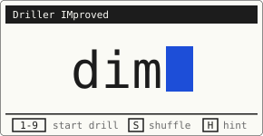
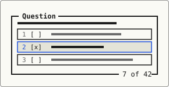

<p align="center">
  <picture>
    <source media="(prefers-color-scheme: dark)" srcset="assets/dim-dark.svg">
    
  </picture>
</p>

# Driller IMproved (dim)

A keyboard-driven, TUI-styled driller for multiple-choice questions. Import a drill as JSON, pick answers with the number keys, check with `Space`, and review everything you missed at the end.

No build step, no dependencies, no server: plain HTML, CSS, and JavaScript. Check it out at <https://pseja.github.io/dim>.

<p align="center">
  <picture>
    <source media="(prefers-color-scheme: dark)" srcset="assets/dim-q-dark.svg">
    
  </picture>
</p>

## Features

- **Number-key answering:** toggle options with `1-9` (and `0` for the tenth), check with `Space`.
- **Partial credit:** a question is
  - *green* when every correct answer is picked and no wrong ones,
  - *orange* when only correct answers are picked, but not all of them,
  - *red* when any wrong answer is picked.
- **Review at the end:** step through the questions you did not fully get right, or drill just those again.
- **Browse while drilling:** go back to already answered questions (read-only) with the arrow keys or `j`/`k`.
- **Optional hint:** show how many answers are correct, toggled with `H`.
- **Shuffle:** question order (toggled with `S`) is randomized.
- **Colour themes:** press `T` to pick a theme in a dialog with a live preview.
- **Bulk delete:** press `D` on the menu, toggle the drills you no longer want with the number keys or the mouse, and delete them together.
- **Clickable key hints:** (almost) every shortcut in the footer can also be clicked.
- **Saved locally:** imported drills, the hint setting, and the chosen theme are saved in your browser's `localStorage`.

## Usage

Open [`index.html`](index.html) in a browser or at <https://pseja.github.io/dim>.

### Importing a drill

Drop a JSON file onto the import box, click it to browse, or paste the text into the text area. Each question has a `question`, a list of `correct` answers (at least one), and a list of `wrong` answers (can be empty):

```json
[
    {
        "question": "What is A?",
        "correct": ["A1", "A2"],
        "wrong": ["X1", "X2", "X3"]
    },
    {
        "question": "How does B work?",
        "correct": ["B1", "B2", "B3", "B4"],
        "wrong": []
    }
]
```

A JavaScript-literal array (unquoted keys, trailing `;`) is accepted as well.

Any question with a line starting with `" |"` is rendered in monospace, so you can use it for tables.

### Keyboard shortcuts

| Screen  | Key               | Action                                |
| ------- | ----------------- | ------------------------------------- |
| Menu    | `1-9`             | Start the n-th drill                  |
|         | `D`               | Delete drills                         |
|         | `S`               | Toggle question shuffling             |
|         | `H`               | Toggle the hint                       |
|         | `T`               | Choose a theme                        |
| Drill   | `1-9`, `0`        | Toggle an option                      |
|         | `Space`           | Check, then next (or back to current) |
|         | `j` `→` / `k` `←` | Next / previous question              |
|         | `H`               | Toggle the hint                       |
|         | `Esc`             | Quit the drill                        |
| Results | `R`               | Review missed questions               |
|         | `D`               | Drill the missed questions again      |
|         | `N`               | Restart                               |
|         | `M` / `Esc`       | Back to the menu                      |
| Review  | `j` `→` / `k` `←` | Next / previous missed question       |
|         | `D`               | Drill these again                     |
|         | `Esc`             | Back to the results                   |

## Project structure

```sh
.
├── index.html # entry point
├── assets/    # SVG logos and favicon
├── css/       # tokens, base, layout and component styles
└── js/        # state, session logic, views and keyboard handling
```

The scripts are plain (non-module) files loaded in order from `index.html`, so the app also works when opened straight from disk.

## Inspired by

- **[Fancy-Driller](https://github.com/AdamBalu/Fancy-Driller)** by [AdamBalu](https://github.com/AdamBalu): the driller this project started from, and the source of the JSON import format.
- **[lazygit](https://github.com/jesseduffield/lazygit)** by [Jesse Duffield](https://github.com/jesseduffield): the look of titled boxes with the position counter on the bottom border and the footer of key hints.
